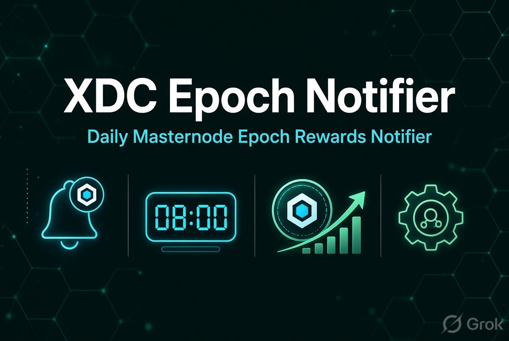

# XDC Epoch Notifier



**Daily XDC masternode epoch rewards, pushed to your phone.**
Every morning at 08:00 (Sydney time by default) it works out exactly how much each of your masternode owner addresses earned since the last report and sends it to your [ntfy](https://ntfy.sh) topic. If a node earned nothing, or the check couldn't run, you get a loud alert instead of a quiet report.

For more projects, visit [XDC Outpost](https://s4njk4n.github.io/XDCOutpost/).

## What a notification looks like

```
XDC rewards: +2,160.00 XDC

✅ xdcabcd…1234: +2,160.0000 XDC
   48 epochs · 45.0000 XDC per epoch
   23 Nov 08:00 → 24 Nov 08:00 AEDT (24h)
   7-day total: 15,120.00 XDC (avg 2,160.00/day)
   Balance: 10,020,118.50 XDC
```

Tap it to open the address on XDCScan. Several nodes on the same topic arrive as **one** notification with a total.

| Situation | What you get |
|---|---|
| Rewards received | Normal-priority report (amount in the title, so you can read it without opening) |
| **No rewards** in the period | ⚠️ High-priority alert: check the node is online and still a masternode |
| Unexplained balance drop | ⚠️ High-priority alert |
| RPC / Etherscan down | ⚠️ "Couldn't check" alert. Nothing is lost: the next report covers the gap |
| First run | Last 24 h if the RPC keeps history, otherwise "tracking started" |

## How rewards are worked out

Epoch rewards aren't ordinary transactions, so they're inferred, the same way as [XDC_Masternode_Rewards_Calculator](https://github.com/s4njk4n/XDC_Masternode_Rewards_Calculator):

```
rewards = balance change − (transfers in − transfers out − gas fees)
```

Each run remembers the exact block it stopped at, so late, skipped or failed runs never lose or double-count rewards. Sending or receiving XDC on the owner address doesn't distort the figure.

## Setup (free, runs on GitHub Actions)

### 1. Get what you need

**Etherscan API key** (free; one key covers XDC):
1. Sign up at [etherscan.io/register](https://etherscan.io/register).
2. Open [API Keys](https://etherscan.io/myapikey), click **Add**, name it (e.g. "XDC Epoch Notifier") and copy the key.

**ntfy** (free push notifications, no account needed):
1. Install the app: [iOS](https://apps.apple.com/us/app/ntfy/id1625396347) · [Android](https://play.google.com/store/apps/details?id=io.heckel.ntfy).
2. Subscribe to a topic name that's hard to guess, e.g. `xdc-rewards-7f3k9q2m`. Anyone who knows the name can read it.

### 2. Fork and configure

1. **Fork this repo** (top-right button).
2. In your fork, open the **Actions** tab and click **I understand my workflows, go ahead and enable them**. Scheduled runs don't start on forks until you do this.
3. Go to **Settings → Secrets and variables → Actions → New repository secret** and add:

| Secret | Value |
|---|---|
| `XDC_REWARDS_CSV` (required) | One line per masternode, see below |
| `ETHERSCAN_API_KEY` (optional) | Your key, if you'd rather not repeat it on every line |
| `NTFY_TOKEN` (optional) | Access token, if you use a protected ntfy topic |

`XDC_REWARDS_CSV` format, no header needed. The address can start with `xdc` or `0x`; the key column can be left off if you set `ETHERSCAN_API_KEY`:

```
xdcYourMasternodeOwnerAddress1,your-ntfy-topic,YourEtherscanAPIKey
xdcYourMasternodeOwnerAddress2,your-ntfy-topic
```

4. **Test it now**: Actions → *XDC Masternode Epoch Rewards Notifier* → **Run workflow**. You should get a notification within a minute or two.

From then on it runs every day at 08:00 Sydney time.

### Optional settings

Under **Settings → Secrets and variables → Actions → Variables**:

| Variable | Default | What it does |
|---|---|---|
| `REPORT_TZ` | `Australia/Sydney` | Time zone for dates in the report ([IANA name](https://en.wikipedia.org/wiki/List_of_tz_database_time_zones)) |
| `NTFY_SERVER` | `https://ntfy.sh` | Your own ntfy server |
| `XDC_RPC_URLS` | `https://erpc.xinfin.network,https://rpc.ankr.com/xdc` | RPC endpoints, tried in order |

To change the delivery time, edit the `cron` and `timezone` lines in `.github/workflows/xdc-rewards-notifier.yml`.

## Privacy and security

- Secrets stay in GitHub's encrypted secrets. Nothing sensitive is committed.
- The workflow commits `last_balances.json` each day to remember where it stopped. Addresses in it are stored as hashes, not in plain text. The daily commit also keeps GitHub from pausing the schedule for inactivity.
- Notifications show a shortened address (`xdcabcd…1234`).

## Troubleshooting

- **No notification?** Open the Actions tab and look at the latest run; errors are shown in plain words. Check the topic in the app matches the CSV exactly.
- **"isn't a valid XDC address"**: the address must be 40 hex characters after `xdc`/`0x`.
- **"Etherscan rejected the API key"**: re-copy the key in full.
- **First run says "tracking started"**: normal when the RPC doesn't keep historical balances. The first full report arrives the next morning.

Run the tests locally with `python3 -m unittest discover -s tests -v`, or try it against the live network without sending anything:

```
XDC_REWARDS_CSV="xdc...,topic,KEY" DRY_RUN=1 python3 xdc_epoch_notifier.py
```

## Related projects
- [XDC_Masternode_Rewards_Calculator](https://github.com/s4njk4n/XDC_Masternode_Rewards_Calculator): rewards over any period, in your browser
- [XDC_Tycoon](https://github.com/s4njk4n/XDC_Tycoon): masternode status and reward top-up alerts
- [XDC_Sentinel](https://github.com/s4njk4n/XDC_Sentinel): node uptime monitoring

---

Made with ❤️ for the XDC community. MIT licence. Use at your own risk; no warranties provided.
